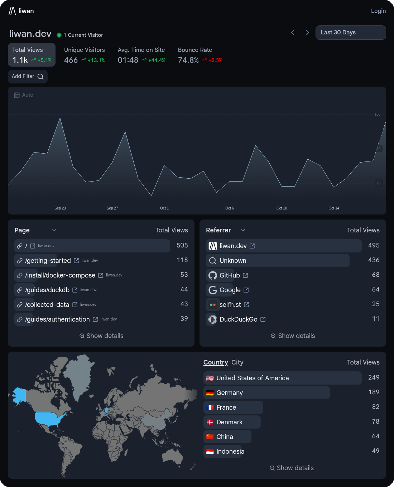
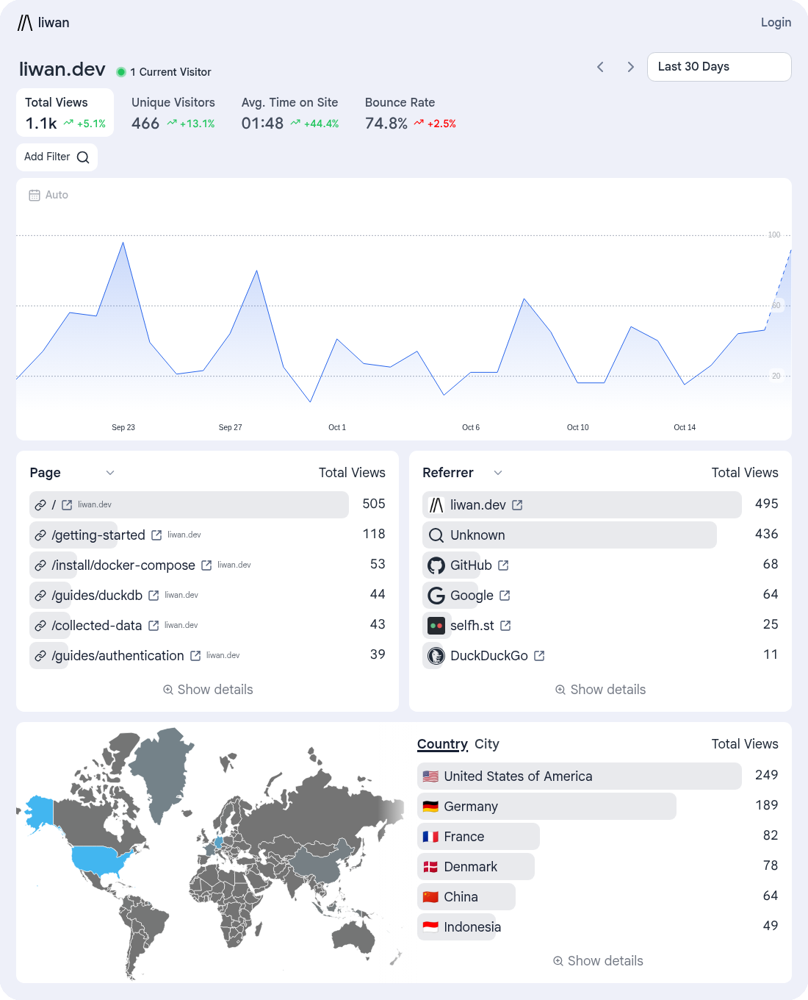

<br/>

<div align="center">
    <h2>
        
        <a href="https://liwan.dev">liwan.dev</a> - Self-hosted, privacy-first web analytics
    </h2>
<div>


[](https://github.com/franzos/liwan/pkgs/container/liwan)

[Live demo](https://demo.liwan.dev/p/liwan.dev) · [Getting started](https://liwan.dev/getting-started/) · [Configuration](https://liwan.dev/reference/configuration/) · [Collected data](https://liwan.dev/collected-data/)

</div>

</div>

<div align="center">
<a href="https://demo.liwan.dev/p/liwan.dev"></a>&nbsp;&nbsp;&nbsp;
<a href="https://demo.liwan.dev/p/liwan.dev"></a>
</div>

## Features

**Understand your traffic**\
See your most-visited pages, where visitors come from, and how traffic changes over time. The dashboard updates automatically, with bot filtering enabled by default.

**Easy to self-host**\
Run Liwan as a single binary or Docker container. The dashboard and database are built in, with no additional services to manage.

**Privacy first**\
No tracking cookies or cross-site tracking. Your analytics data stays on your server, and you control what’s collected and how long it’s kept.
[Read more about data collection](https://liwan.dev/collected-data/).

**Collect only what you need**\
Choose what data to collect and how long to keep it. Location detail is adjustable, and campaign attribution and session metrics can be disabled independently.

**Lightweight tracking**\
Add a small tracking script to your website with a single line of HTML. Works with any framework or CMS.

**Single sign-on**\
Manage accounts with Google Workspaces, Microsoft Entra, Forseti, or your own OpenID Connect provider like Keycloak or Dex - several at once, if you need to.

### OIDC/SSO

This fork focuses on OIDC/SSO login. For everything else - sites, users, roles, tracking, and the rest - see the docs at [liwan.dev/getting-started](https://liwan.dev/getting-started/).

Sign in with a username and password, or connect one or more identity providers over OIDC/SSO. Each configured provider gets its own button on the login page, and accounts are provisioned on first login. The username is taken from the provider's `preferred_username`, then a verified email, and - when neither is available - the user's name (`José Müller` becomes `jose-muller`), falling back to the opaque subject only as a last resort. The account is matched on the provider's subject, so email or name changes never break the link. The first admin is created through a one-time setup flow, and accounts can also be managed from the CLI.

Providers live in the config file, not in an admin UI: they are deployment configuration, and a dashboard admin should not be able to point authentication somewhere else.

#### Configuration

Liwan reads a single TOML file. It looks for `./liwan.config.toml`, then `$XDG_CONFIG_HOME/liwan/config.toml` (i.e. `~/.config/liwan/config.toml`), or you can point it at an explicit path with `--config <path>` or the `LIWAN_CONFIG` env var. Any value can also be overridden with a `LIWAN_*` environment variable (e.g. `LIWAN_OIDC_PROVIDERS_COMPANY_CLIENT_SECRET`), which is the recommended way to pass secrets. A fully annotated example lives in [`data/config.example.toml`](data/config.example.toml).

```toml
base_url = "https://analytics.example.com"  # external URL of this instance (used to build the OIDC redirect URI)
listen   = 9042                             # local http port to bind, typically behind a reverse proxy
# data_dir = "./liwan-data"                 # defaults to ~/.local/share/liwan/data
```

#### Single sign-on

Add one `[oidc.providers.<name>]` table per identity provider. Each one becomes a button on the login page; password login keeps working alongside them. `<name>` is lowercase letters, digits and hyphens - it shows up in URLs and in environment variable names, so prefer one without hyphens if the secret comes from the environment.

```toml
[oidc.providers.company]
kind          = "oidc"                      # oidc (default) | forseti | google | microsoft
display_name  = "Company SSO"               # defaults to the kind's own name
issuer        = "https://idp.example.com"   # discovery lives under it
client_id     = "liwan"
client_secret = "..."                       # prefer LIWAN_OIDC_PROVIDERS_COMPANY_CLIENT_SECRET
```

Register this redirect URI with every provider (derived from `base_url`):

```
<base_url>/api/dashboard/auth/external/callback
```

liwan logs that URI at startup, along with the per-provider back-channel logout and account-deletion URLs, so you don't have to reconstruct them from here.

First-time users are created as regular users with no project access until an admin grants it. Accounts are matched on the provider's subject, so a later email or name change never breaks the link. SSO-only accounts have no password: the settings page hides the password form for them, and the API refuses to set one.

The four kinds differ only in what they derive for you:

| `kind`      | Issuer                                             | Extras |
| ----------- | -------------------------------------------------- | ------ |
| `oidc`      | your `issuer`                                      | configurable `scopes` |
| `forseti`   | your `issuer`                                      | manage-account link, account-deletion webhook |
| `google`    | `https://accounts.google.com`                      | `allowed_domains` checks the `hd` claim |
| `microsoft` | derived from `tenant_id`                           | logins are confined to that tenant |

`microsoft` requires `tenant_id` as the tenant UUID - `common` and friends are refused, because they would let any tenant in. `scopes` is only configurable for `kind = "oidc"`; the presets know what their own provider accepts.

Every option also takes an environment override, named `LIWAN_OIDC_PROVIDERS_<NAME>_<KEY>` (for the `groups` sub-table, `LIWAN_OIDC_PROVIDERS_<NAME>_GROUPS_<KEY>`). List values accept a comma-separated string.

#### Who may sign in

Three independent gates, all checked on **every** login rather than only at sign-up:

```toml
[oidc.providers.company]
# ... issuer, client_id, client_secret as above ...

registration    = "open"                       # open (default) | closed
allowed_domains = ["example.com", "acme.org"]  # optional
```

- **`registration`** - `closed` stops new accounts being created. People who already have one still sign in, so this is what you want once everyone intended is enrolled.
- **`allowed_domains`** - the **verified** email's domain must be in the list. An unverified address never qualifies, so the `email` scope is required. Matching is exact and case-insensitive: `example.com` does **not** cover `sub.example.com`. Configure non-ASCII (IDN) domains in punycode. For `kind = "google"` this checks the Workspace domain (`hd`) instead, which is the claim Google actually vouches for.

Rejections send the person back to the login page with a short explanation; the reason behind it stays in the server log.

#### Mapping groups to roles and projects

When your provider emits a group claim, liwan can derive the role and project access from it:

```toml
[oidc.providers.company.groups]
claim    = "groups"                                           # the claim to read; this is the default
allowed  = ["analytics"]                                      # optional: must be in one of these to sign in
admin    = ["liwan-admins"]                                   # members get role admin, everyone else user
projects = { marketing = ["blog", "docs"], eng = ["app"] }    # group -> project ids
```

Role and projects are rewritten on **every** sign-in, so a group change at the provider takes effect the next time the person logs in, and local edits to such an account do not survive it. Project ids that don't exist are skipped with a warning.

This only ever touches accounts without a local password. An account created locally, or attached with `link-oidc`, is left alone - which is what stops your break-glass admin being demoted by a group that went missing.

#### Signing out

Point your provider's `backchannel_logout_uri` at:

```
<base_url>/api/dashboard/auth/external/<name>/backchannel-logout
```

When someone signs out at the provider, liwan ends the session on that device. If the logout token names no device, every session that account has goes, password logins included. Role and group changes are **not** covered - no such event exists; they apply at the next login. liwan's own sign-out button is local and does not reach the provider.

#### Forseti

[Forseti](https://github.com/franzos/forseti) is supported as a first-class kind. Use its `liwan` app template to register the client, then:

```toml
[oidc.providers.company]
kind       = "forseti"
issuer     = "https://hydra.example.com"     # Forseti's OIDC issuer
portal_url = "https://accounts.example.com"  # optional; Forseti's own URL, defaults to issuer
client_id  = "liwan"
```

On top of the usual flow this adds:

- **Groups.** `kind = "forseti"` requests the `groups` scope whenever a `groups` table is configured. The claim is the team slugs of the user's *active* organisation, re-resolved at every sign-in. Someone in several organisations gets the active one's teams.
- **A manage-account link.** The settings page links out to Forseti instead of showing a password form.
- **Account deletion.** When someone deletes their account in Forseti, it posts a signed RISC event to:

  ```
  <base_url>/api/dashboard/auth/external/<name>/account-deletion
  ```

  Set that as `account_deletion_url` on the Hydra client. An account that only ever signed in through Forseti is deleted outright, along with its sessions. One that also has a local password keeps working as a local account; only the link goes.

If Forseti's discovery document can't be reached, the extras stay off and logins carry on as usual.

#### Linking an existing account

To make SSO land on an account that already exists - typically the first admin, created with a password - attach the provider's subject to it. The account keeps its role, projects and password:

```
liwan link-oidc <username> <subject>                      # when one provider is configured
liwan link-oidc <username> <subject> --provider company   # when several are
liwan link-oidc <username> <subject> --issuer https://idp.example.com
liwan link-oidc <username> <subject> --replace            # also delete the duplicate holding that subject
```

The subject is the `sub` claim your provider issues for that person; it usually shows up as the identity ID in the provider's admin UI. `--replace` only removes accounts without a local password - a real account is never collateral.

#### Upgrading from 1.6.0-fork

The `[oidc]` table of earlier fork releases is gone, and a config that still uses it fails to start with a message naming the replacement. In order:

1. **Add the new redirect URI** to your provider, alongside the old `/api/dashboard/auth/oidc/callback`. Both can coexist; remove the old one after the upgrade.
2. **Rewrite the config.** `[oidc]` becomes `[oidc.providers.<name>]`; `button_label` becomes `display_name`; `LIWAN_OIDC_CLIENT_SECRET` becomes `LIWAN_OIDC_PROVIDERS_<NAME>_CLIENT_SECRET`. `registration = "domain_allowlist"` becomes `registration = "open"` with the same `allowed_domains` - which now applies on every login, not only at sign-up. Keep `issuer` byte-identical to what you have today: existing links are keyed on it.
3. **Back up the data directory, then start the new binary.** The migration carries your existing links over to the new table. Sessions are untouched, so nobody is signed out.
4. **Don't configure a `groups` table yet** - not until the matching teams exist at your provider. An SSO-only account you promoted to admin by hand would be demoted at its next sign-in once group mapping is on.
5. Optionally register `backchannel_logout_uri`, and `account_deletion_url` for `kind = "forseti"`.


### Importing from Matomo

Liwan can import historical pageviews from a Matomo instance. The importer is opt-in at build time — default builds don't include it:

```bash
cargo build --release --features import-matomo
```

You need Matomo 5.0 or newer (the importer checks before doing anything else), an API token, and the liwan server must be **stopped** — DuckDB allows a single writer, the same limitation `prune` has.

```bash
MATOMO_TOKEN=... liwan import matomo \
  --url https://matomo.example.com \
  --site 3=blog --site 7=docs \
  --since 2022-01-01
```

- `--site <idSite>=<entity_id>` maps a Matomo site to a liwan entity. Repeatable; one entity per site, and the entity must already exist.
- `--since YYYY-MM-DD` is required on the first run per site.
- The token can also be passed with `--token`, but prefer `MATOMO_TOKEN` — CLI arguments leak via `ps` and shell history.
- `--page-size <n>` sets visits per API request (default 1000); `--dry-run` fetches and maps without writing anything.
- `--drop-local-urls` skips pageviews whose URL host is `localhost` or a private/reserved IP (e.g. `127.0.0.1`) — useful for filtering local development traffic that was tracked into Matomo. Off by default, to match live tracking (which keeps these).
- `--max-retries`, `--retry-base-delay` (seconds) and `--page-delay` (milliseconds) tune rate-limit handling. A 429 (or a transient 5xx/timeout) backs off exponentially and retries instead of aborting the site; `--page-delay` adds a fixed pause between pages so a large site self-throttles before it ever hits the limit.

#### Batch import against a Docker deployment

When liwan runs in Docker, the same single-writer rule applies: stop the service, run a one-off importer container with `docker compose run`, then start it again. A small wrapper handles a list of sites, a cooldown between them, and Ctrl-C:

```bash
#!/usr/bin/env bash
set -euo pipefail

# DuckDB is single-writer — the server has to be down while we import.
# Restart it on Ctrl-C so an abort doesn't leave tracking offline.
trap 'echo; echo "Aborted."; docker compose start liwan; exit 130' INT

COOLDOWN="${COOLDOWN:-15}"   # seconds between sites, so Matomo doesn't 429 the next import

run() {
    docker compose run --rm -e MATOMO_TOKEN liwan \
        import matomo \
        --url https://matomo.example.com \
        --site "$1" \
        --since 2022-01-01 \
        --page-delay 250
    sleep "$COOLDOWN"
}

docker compose stop liwan        # release the DB writer lock
run 3=blog
run 7=docs
docker compose start liwan       # bring tracking back up
```

Export the token in the parent shell first (`export MATOMO_TOKEN=...`) so `-e MATOMO_TOKEN` passes it through without baking it into the script. Replace `liwan` with your compose service name. Because re-runs are incremental, a site that 429s past its retries can just be run again — it resumes from its checkpoint.

Re-runs are incremental. The importer keeps a per-site checkpoint file under `<data_dir>/import/` and only fetches what's newer, in month-sized chunks. There's a one-hour lateness allowance: actions that arrive in Matomo more than about an hour after the fact (QueuedTracking, log importer) fall below the watermark and won't be picked up by later runs. To re-import from scratch, delete the checkpoint file and run again with `--since` — that's safe, since resuming first deletes previously imported rows newer than the watermark.

The importer refuses to run when the target entity has day-based data retention or a drop rule that would discard every imported event — the next prune would just delete the history again. `--force` overrides this if you know what you're doing.

Do expect the numbers to differ from Matomo's own, and from live liwan tracking:

- Cookieless Matomo sites count uniques per day, so liwan shows more unique visitors over multi-day ranges. Imported visitors are also distinct from live visitors — someone tracked by both appears twice.
- Only pageviews are imported; downloads, events, and goals between pageviews are dropped, which skews bounce rate and time-on-site (bounce rate generally higher).
- Time-on-site isn't comparable to Matomo's: liwan averages the gap between consecutive pageviews (single-page sessions excluded), while Matomo divides total visit length by all visits (bounces counted as zero). On bounce-heavy sites liwan's figure reads much higher. This is how liwan computes the metric for live data too, not an import artifact.
- Bot filtering is Matomo's, not liwan's. Device and OS mapping is best-effort. City names can differ between GeoIP databases.
- Imported visitor ids are derived from the persistent id Matomo assigned and don't rotate daily like live ones. A visitor who came back over a week is one unique visitor across an imported range, but up to seven across a live one, so multi-day unique counts read lower for imported periods.

## Fork

This is a fork of [explodingcamera/liwan](https://github.com/explodingcamera/liwan), adding support for an OIDC/OAuth login flow.

The fork adds its own database migration, numbered in the same sequence as upstream's. Upstream migrations added after the fork point are renumbered on each sync, so a data directory created by an upstream release won't start on the fork: refinery sees a divergent migration history and refuses. Start from an empty data directory, or stay on upstream.

## License

Unless otherwise noted, the code in this repository is available under the terms of the Apache-2.0 license. See [LICENSE](LICENSE.md) for more information.
